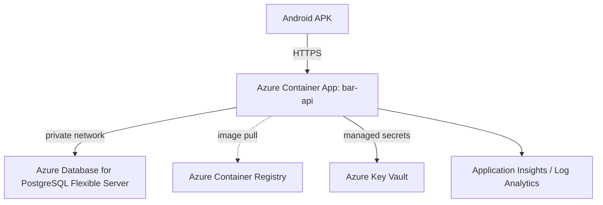

# Azure Deployment Plan — Bar do Zico

**Status:** Blocked — not validated; current review in `docs/REVISAO-REDE-E-AZURE.md`  
**Mode:** MODIFY existing project  
**Branch:** `azure-cloud-pilot`  
**Scope:** Isolated non-production pilot only

## Objective

**Confirmed on 20/10/2026:** Azure remains the cloud provider. Android must
eventually work over 4G/other networks; the residential Windows connection keeps
its Public profile. Local operation during an Internet outage remains required.
Cloud/local data synchronization and device authorization without a daily login
are not implemented and are release blockers for switching real operation.

Publish the Java API over public HTTPS so the Android APK can connect using
Internet access. Keep the current Docker/PostgreSQL installation and real data
local and unchanged.

## Confirmed context

- Azure account: `raphael.2517990@aluno.faculdadedescomplica.com.br`
- Subscription: `Azure subscription 1`
- Subscription ID: `5da250f6-41bb-47db-bdda-7df7ad2fb10c`
- Tenant: `DESCOMPLICA CURSOS LIVRES VIA WEB S.A.`
- Intended region: Brazil South
- Public domain: none yet; use Azure-provided HTTPS hostname for the pilot
- Pilot data: empty database
- Deployment path: Azure CLI plus Bicep

## Application

- Java 25 and Spring Boot 3.5.16 API
- React/TypeScript frontend bundled into the API static resources
- PostgreSQL persistence
- Existing root `Dockerfile`
- Container port: `8080`

## Target architecture



Only the API is public. PostgreSQL must not be exposed directly to the
Internet. Credentials must not be committed to the repository or embedded in
the APK.

## Azure resources

- Resource group: `rg-bar-zico-pilot`
- Container Apps environment and app `bar-api`
- Azure Container Registry
- Azure Database for PostgreSQL Flexible Server with an empty pilot database
- Private networking between the API and PostgreSQL
- Key Vault for runtime secrets
- Log Analytics/Application Insights
- User-assigned managed identity with only required permissions

Use the smallest pilot-appropriate SKUs that are available in Brazil South;
validate availability before generating final infrastructure.

## Runtime configuration

```text
DB_URL
DB_USERNAME
DB_PASSWORD
BAR_ALLOWED_HOSTS
BAR_ANDROID_URLS
BAR_UNIT_ID
BAR_BIND=0.0.0.0
BAR_PORT=8080
BAR_OPEN_ACCESS=false
BAR_SECURE_COOKIE=true
BAR_TRAINING=false
```

## Execution and validation gates

1. Review and approve this plan.
2. Validate region, quota, permissions, and service/SKU availability.
3. Generate and syntax-check Bicep infrastructure.
4. Build and vulnerability-scan the container image.
5. Provision only the isolated pilot resources.
6. Deploy the API and initialize the empty database.
7. Validate HTTPS health, authentication, API behavior, and Android connectivity.
8. Do not migrate production data or switch the production APK until all pilot
   checks pass.

## Safety constraints

- No production data migration in this phase.
- No public PostgreSQL endpoint.
- No `BAR_OPEN_ACCESS=true`.
- No deletion or modification of the local Docker environment.
- No deployment before validation passes.

## Earlier validation result (historical; superseded by the review below)

**Status:** Blocked — not validated

The official validation workflow could not start because the Windows sandbox
blocked the PowerShell workflow script's local-network initialization. Independent
repository inspection also found these blockers:

- No Bicep, Terraform, or `azure.yaml` infrastructure exists yet.
- The empty Azure database has no completed schema/user/bootstrap procedure.
- `BAR_UNIT_ID` has no pilot establishment/bootstrap value.
- Android URL validation currently expects numeric IP addresses with explicit
  ports, so it cannot accept an Azure DNS hostname.
- Region, quota, SKU availability, RBAC, image build, and vulnerability scan
  have not been verified.

The plan is not validated. The remaining infrastructure and release checks must
pass before an actual deployment or any claim of Azure validation.

## Applied repository fixes

- HTTPS setup addresses now accept validated DNS hostnames, including the
  Azure-provided Container Apps hostname.
- Android connection text distinguishes residential access from a configured
  cloud server. A failed real Azure URL is retained, never silently replaced
  with a different local database.
- `scripts/bootstrap_azure.py` now provides an idempotent empty-database
  establishment, administrator, role, and permission bootstrap. It uses
  environment-provided secrets only.

## Review validation — 20/10/2026

- Local HTTPS ports 8443/18443 restored alongside DNS HTTPS/443 validation.
- 58 API/address tests passed against disposable PostgreSQL, plus 40 UI cases
  for desktop/mobile viewport and Android Java connection tests.
- Docker image built locally as `bar-do-zico:revisao-20261020`, non-root runtime.
- `scripts/validar_nuvem.py` passed locally: concurrent/idempotent bootstrap,
  preserved password, authenticated API behind forwarded HTTPS and secure cookies.
- Existing local operation/training records preserved and backups restore-tested.
- Official Azure CLI installed under `.tools` and authenticated. Read-only
  inventory confirmed this subscription is Enabled, with zero resource groups
  and zero resources. Quotas, costs, real endpoint, IaC, deployment and 4G tests
  remain unverified. The earlier subscription-access blocker did not recur.

Older validation notes below describe the earlier attempt; they do not override
this review or prove that any Azure resource currently exists.

## Subscription access — resolved in this review

The earlier tool rejected the subscription context. After authenticating the
official Azure CLI, the same subscription was accessible and Enabled. Its
inventory contains zero resource groups and zero resources. Quotas, SKU/cost
selection and infrastructure deployment still need separate validation.

## Earlier local verification (historical; current tests passed in review above)

- Java 25 compilation/package passed with the Maven Wrapper.
- Azure bootstrap script syntax passed with `python -m py_compile`.
- API tests were blocked because the local PostgreSQL test database was not
  available; the failure occurred while creating the Spring context, not while
  compiling the changed code.
- API main and test sources compile successfully with Java 25 using
  `mvnw.cmd -pl apps/api -am clean test-compile`.
- Azure Verified Modules were queried for Container Apps, managed environments,
  PostgreSQL Flexible Server, Key Vault, Container Registry, and Log Analytics.
- Region and quota checks remain blocked because Azure reports the selected
  subscription as invalid or inaccessible to the infrastructure tools.
